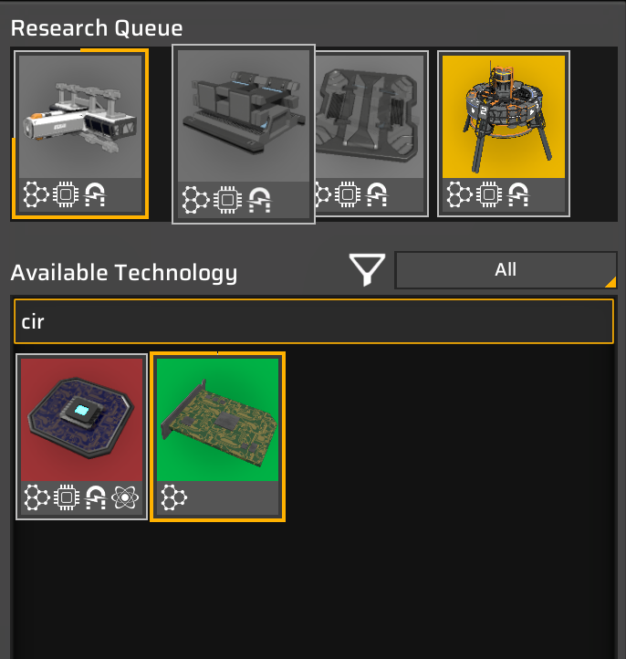
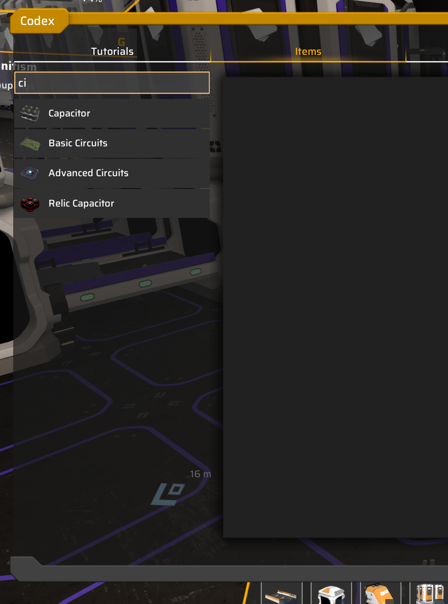

# Elvenide's Research & Codex QoL

**Elvenide's Research & Codex QoL** is a menu quality-of-life mod for **Main Sequence** adding live search bars to the Research and Codex/Help screens plus drag-and-drop research queue reordering, built with UE4SS Lua.

It is designed to feel native to the base game—matching its exact UI style—and is **100% save-safe and removable** without adding custom items, machines, or save dependencies.

## Getting Started

- **[Getting Started & Installation Guide](docs/get-started.md)**

## Research Tree Search & Queue Drag-and-Drop

Adds a live search box to the Research / Technology screen and lets you reorder queued research items via drag-and-drop.

*Research screen showing a queued technology being dragged to reorder alongside the live search filter matching "cir".*

### Features

- **Live Research Search**:
  - Injects a native-styled search bar into the Research screen to filter technologies by display name, description, or unlocked items.
  - Preserves the game's active category/status filter while narrowing results to matching technologies.
- **Queue Drag-and-Drop Reordering**:
  - Drag queued technologies in the research queue list to reorder them cleanly.
  - Reorders via the game's native RPCs so changes remain deterministic and multiplayer-safe.
  - Automatically aborts a reorder if the queue changed mid-drag (for example, if a technology finished researching while dragging).

## Codex / Help Menu Search Bar

Adds a live search bar to the Help / Codex menu (`K`) so you can quickly find items, machines, mechanics, and entries in any tab.

*Live Codex search bar filtering the Items tab in real time for entries matching "ci".*

### Features

- Injects a native-styled search input into the Codex entry list.
- Filters entries in real time as you type (case-insensitive substring match against entry display names).
- Automatically clears the search filter when switching Codex tabs so every tab opens unfiltered.

## Credits

**Elvenide's Research & Codex QoL** is created and maintained by Elvenide. This is an unofficial mod and I'm not affiliated with Main Sequence.

> If you have questions or run into issues, feel free to reach out in #modding-guides within the [official Main Sequence Discord server](https://discord.com/invite/uy8w2pTcQE).
